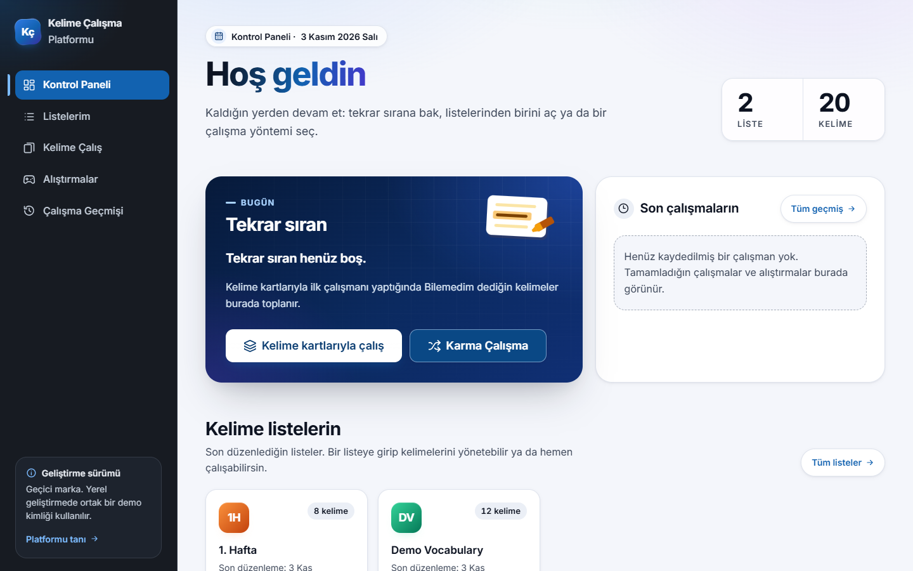
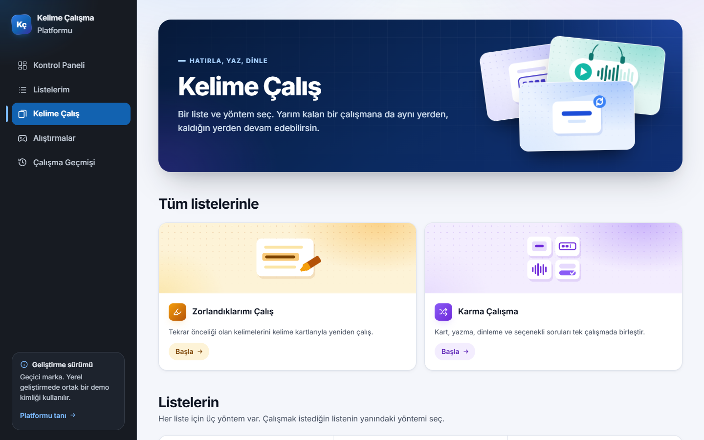
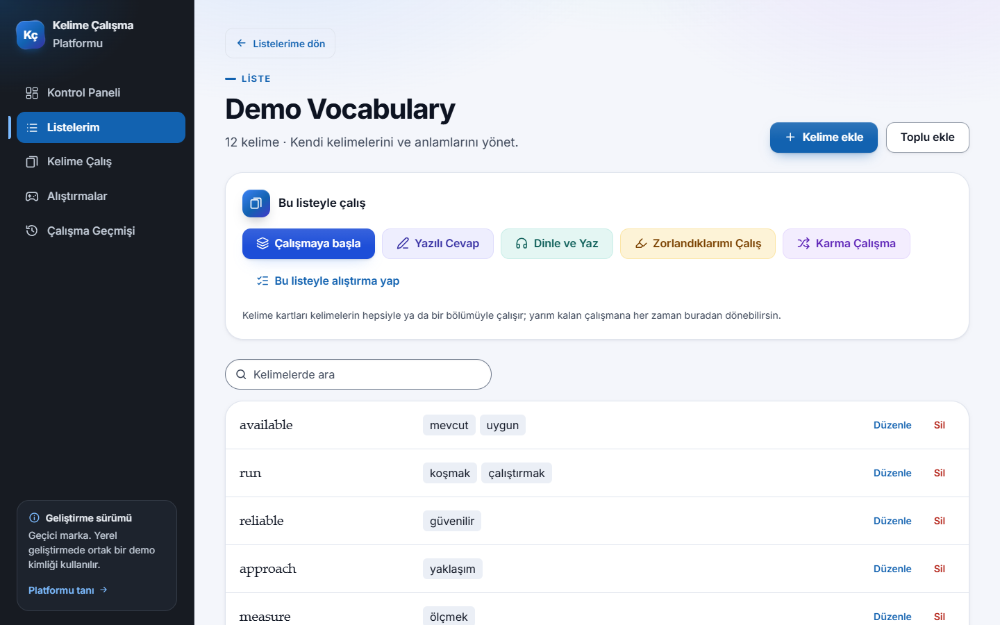
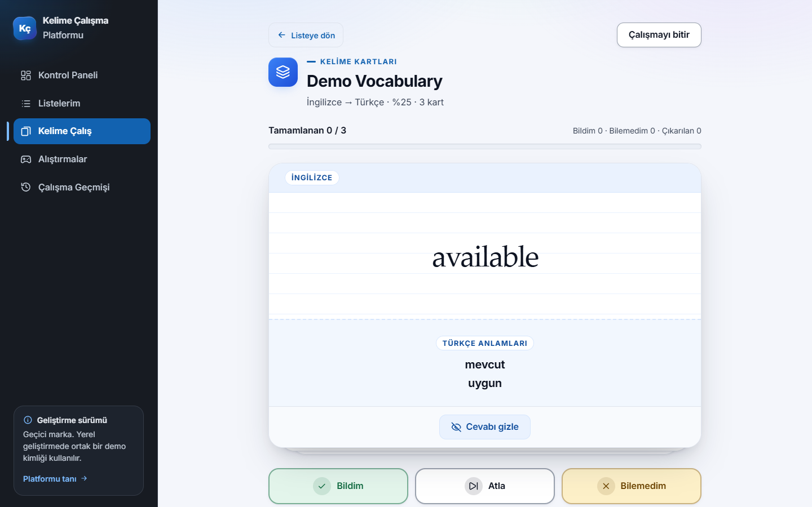
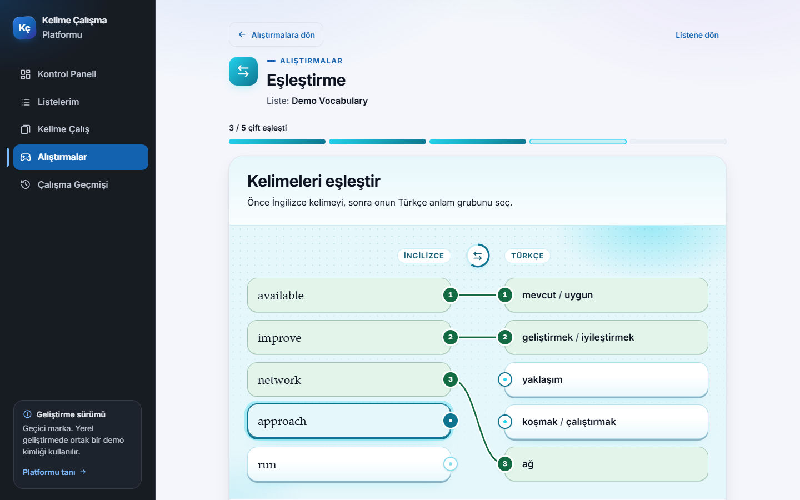
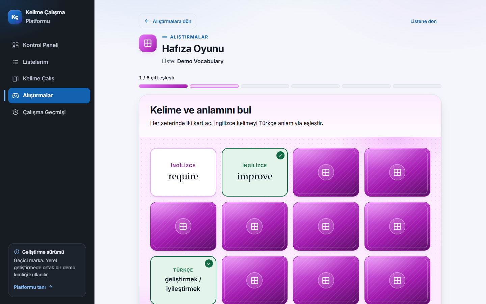
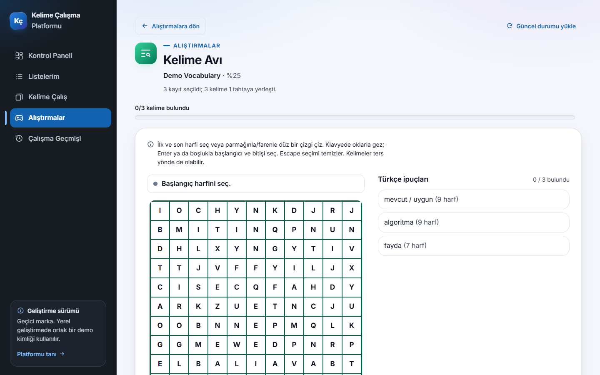
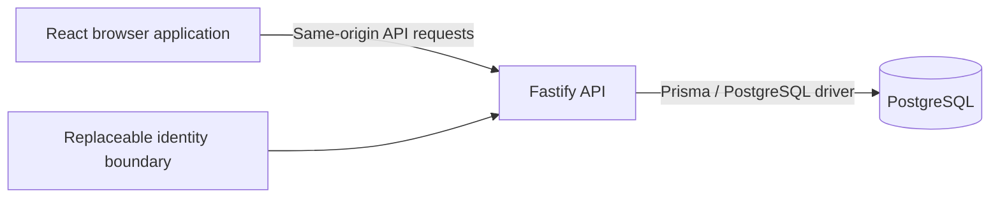

[English](README.md) | [Türkçe](README.tr.md)

# Vocabulary Learning Platform

## Project Overview

A web application for learning English vocabulary with Turkish meanings. Learners create their own lists and use several study activities with the same vocabulary. The application interface is in Turkish; project documentation is available in English and Turkish.

The project began as a **Mesleki Yabancı Dil** course project for students at Adıyaman University. It is an independent development project and does not imply university endorsement or an official university service.

## Features

| Area                             | Implemented behavior                                                                                                                                              |
| -------------------------------- | ----------------------------------------------------------------------------------------------------------------------------------------------------------------- |
| Personal vocabulary lists        | Create, rename and delete lists with freely chosen titles. Add, edit and delete English terms with one or more Turkish meanings.                                  |
| Flashcards — Kelime kartları     | Study in either language direction, reveal the answer and assess your recall.                                                                                     |
| Written recall — Yazılı Cevap    | Read the Turkish meanings and type the English expression; receive deterministic answer feedback.                                                                 |
| Listening — Dinle ve Yaz         | Play the English expression, replay or slow it down, then type what you heard. Audio availability depends on the configured provider or an English browser voice. |
| Mixed practice — Karma Çalışma   | Combine flashcards, written recall, listening and multiple-choice questions in one session, using one list or all your lists.                                     |
| Difficult-word review            | Revisit words marked for review by study results, with focused review sessions.                                                                                   |
| Quiz — Klasik test               | Choose a Turkish meaning group from four options; overlapping meanings are excluded from distractors.                                                             |
| Matching — Eşleştirme            | Connect English terms with Turkish meaning groups; matched pairs share numbered connectors.                                                                       |
| Memory Game — Hafıza Oyunu       | Reveal two cards at a time to find English–Turkish pairs.                                                                                                         |
| Word Assembly — Kelime Oluşturma | Arrange scrambled letters into the English word indicated by its Turkish meanings.                                                                                |
| Word Search — Kelime Avı         | Find English expressions in a letter grid using Turkish clues.                                                                                                    |
| Crossword — Çapraz Bulmaca       | Fill intersecting English answers from Turkish clues.                                                                                                             |
| Sessions and history             | Resume supported study sessions and puzzles, and review completed activities and personal outcomes.                                                               |

Flashcard, written, listening, mixed and puzzle sessions have server-side persistence. Quiz, Matching, Memory and Word Assembly save their results **when the round is completed**; unfinished rounds in those four games are not saved. Some modes need a minimum number of suitable words or have letter/length restrictions; the setup screen explains these conditions.

There are no leaderboards, XP, competitive ranks or shared community vocabulary pools. Optional example sentences are requested explicitly for a selected word; they are not generated automatically. External sentence access and Azure speech are disabled in the default Docker development workflow. Listening can use an available English browser voice and reports unavailable audio when needed.

## Application Screenshots

These screenshots were captured from this source tree running locally with the documented Docker workflow and synthetic vocabulary only. They contain no personal lists or study records. The interface language is Turkish.

**Dashboard**



**Study modes**



**List detail**



**Flashcards**



**Matching**



**Memory Game**



**Word Search**



Installation screenshots are not included; the [Windows guide](docs/INSTALL_WINDOWS.md) shows the exact expected setup output as text. [Screenshot notes](docs/images/README.md) describe how these images were captured.

## Technology Stack

| Layer         | Technologies                                                                  |
| ------------- | ----------------------------------------------------------------------------- |
| Runtime       | Node.js 24.x, npm workspaces                                                  |
| Frontend      | React, Vite, TypeScript 6, Tailwind CSS, Motion, React Router, TanStack Query |
| Backend       | Node.js, Fastify, TypeScript, Zod                                             |
| Database      | PostgreSQL, Prisma ORM 7; PostgreSQL 18.6 in the local Docker workflow        |
| UI assets     | Inter through Fontsource, Lucide icons, project SVG/CSS illustrations         |
| Quality tools | Vitest, Testing Library, Node.js test runner, ESLint, Prettier                |

Exact dependency versions are recorded in `package-lock.json`.

## Architecture Overview



- `apps/web`: pages, shared components, API clients, design tokens and frontend tests.
- `apps/api`: authentication boundary, validation, vocabulary/study services, API routes, Prisma schema, migrations and tests.
- `scripts`: local development orchestration and Docker safety checks.
- `compose.local.yml`: the supported local PostgreSQL setup. The web and API processes run on Windows; PostgreSQL runs in Docker.

Browser code never connects directly to SQL. Personal data is scoped by the API's resolved user identity. Deployment paths are configurable through `VITE_BASE_PATH`, `VITE_API_BASE_PATH` and `API_PREFIX`; production hosting and authentication are not provided by the local setup.

## Quick Start for Windows

Install Git, **Node.js 24.x (at least 24.11.0, below 25)**, WSL 2 and Docker Desktop. Open Docker Desktop with the WSL 2 backend and Linux containers. You do not need to install PostgreSQL or pgAdmin separately. See the [complete Windows guide](docs/INSTALL_WINDOWS.md) for official downloads, PowerShell installation alternatives and troubleshooting.

In a normal PowerShell window, use your home directory:

```powershell
Set-Location $env:USERPROFILE
git clone https://github.com/Z3nes/vocabulary-learning-platform.git
Set-Location .\vocabulary-learning-platform
npm.cmd ci
npm.cmd run local:setup
npm.cmd run local:dev
```

While the repository is private, cloning requires access to it. Do not put credentials in the clone URL.

Open [the application](http://127.0.0.1:5173/). The database initially contains no vocabulary; create a list and add your own words. The public introduction is at `/tanitim`; local diagnostics are at `/dev/status`.

`local:setup` creates an ignored `.env.docker` with random passwords only when that file is absent. It generates Prisma Client, applies the ten versioned migrations and verifies thirteen model tables. Defaults are web port **5173**, API port **3000** and PostgreSQL port **5433**, all on loopback.

**If another checkout already uses this Docker setup on the same computer, stop before setup.** A new folder does not create a new Docker identity. Follow the [second-checkout instructions](docs/INSTALL_WINDOWS.md#second-checkout-on-the-same-computer) to use a distinct Compose project, ports and named volume.

Press **Ctrl+C** to stop the application. Then, from this checkout:

```powershell
npm.cmd run local:stop
```

Stopping PostgreSQL preserves the named volume and local data. After a database stop, run `local:setup` before `local:dev` again.

## Testing

After `npm.cmd ci`, generate Prisma Client before checking the API. Generation does not connect to a database:

```powershell
npm.cmd run prisma:generate -w apps/api
npm.cmd run typecheck
npm.cmd run lint
npm.cmd run test:dev
npm.cmd run test -w apps/web -- --maxWorkers=4
npm.cmd run test -w apps/api -- --maxWorkers=4
npm.cmd run build
npm.cmd run format:check
```

The API command above runs unit tests with mocked database dependencies. For integration tests, first establish your own isolated Docker environment using the installation guide, then run:

```powershell
npm.cmd run local:test:integration
```

This command verifies its target and uses `vocabulary_local_test`, separate from `vocabulary_local` within that container. Do not point tests at a database containing personal study records, and do not run integration suites concurrently. [Local configuration details](docs/LOCAL_DEVELOPMENT.md) describe the supported settings.

## Contributors

The application's existing contributor credits list:

- Murat Kadir YILMAZ
- Muhammed Ali ATEŞ
- Zekeriye Enes AKÇİMEN

## Development and Security Notes

- **Development identity only:** `AUTH_MODE=dev` maps every visitor of that running instance to the same demo identity. User-scoped data structures do not make this a safe public multi-user service.
- `NODE_ENV=production` rejects development authentication. No public registration, production login, university SSO or community list sharing is implemented. Do not expose the development server through a public host, tunnel or port forward. A production build alone does not make the application ready for deployment.
- Keep database URLs and optional provider credentials on the server. Never put secrets in `VITE_*` settings, screenshots, issues or commits. Real environment files and generated output are excluded by `.gitignore`.
- The supported Docker workflow does not use separately configured database URLs. It verifies container identity, loopback binding and storage before migrations. Preserve local passwords and volumes; deleting volumes or resetting databases is not a routine repair.
- Optional sentence/audio providers have their own availability, attribution and usage conditions. Their integration is not a guarantee of service or permission to redistribute provider output.
- No project license has been selected. Contributor approval is required before adding one; this candidate does not claim an open-source license. Existing third-party notices are documented separately in [Third-party notices](docs/THIRD_PARTY_NOTICES.md).
