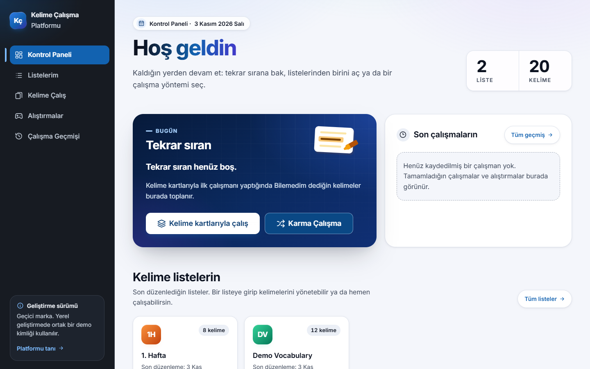
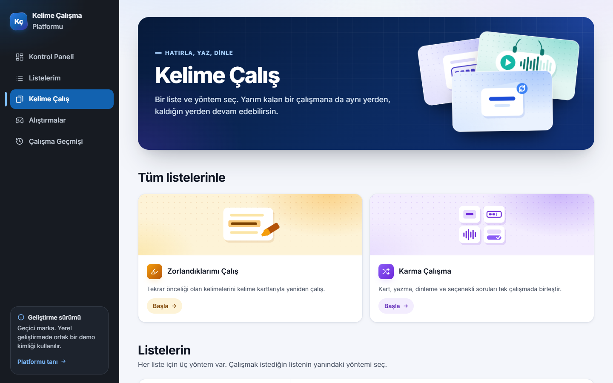
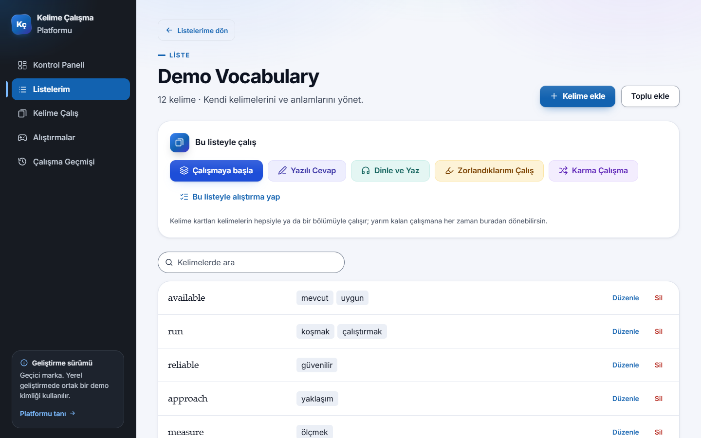
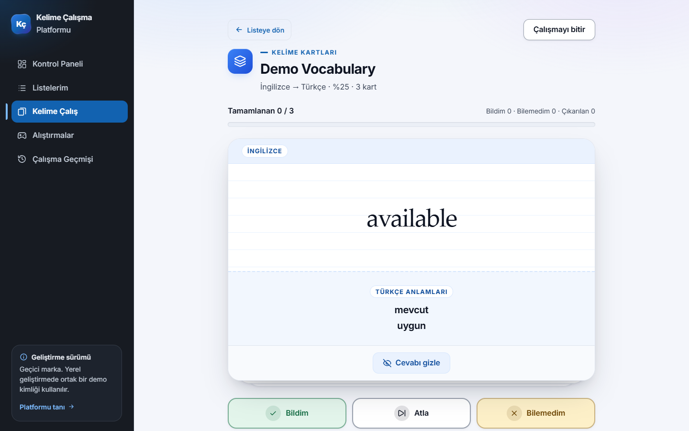
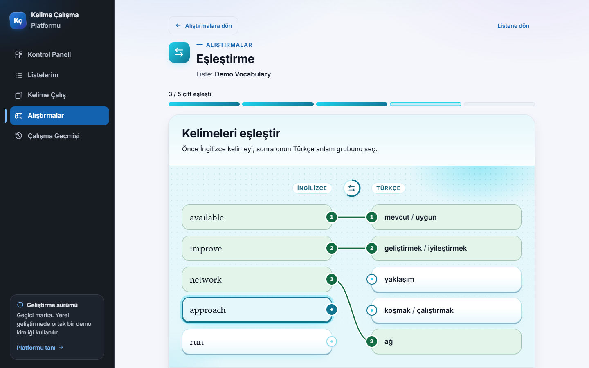
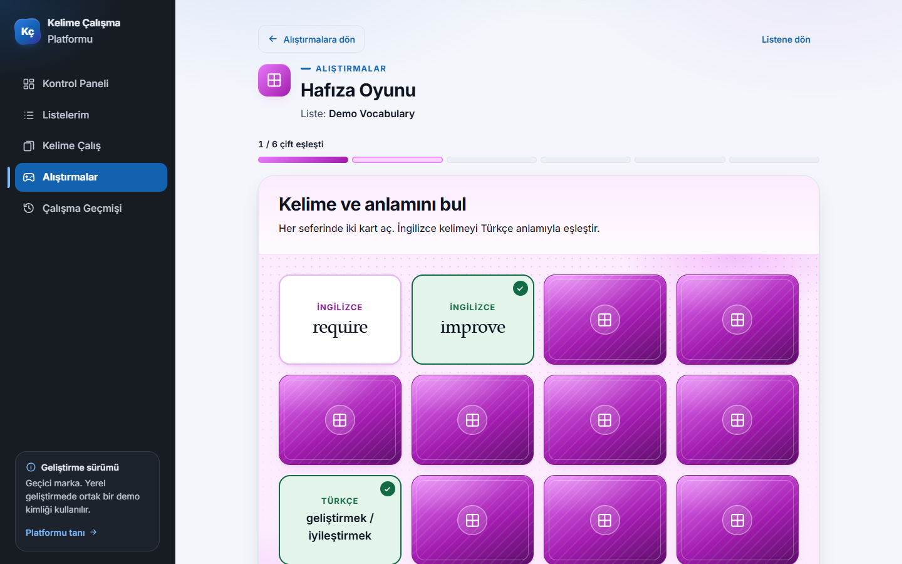
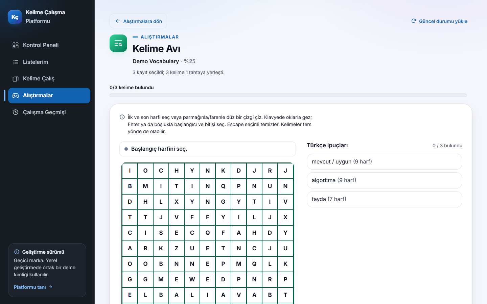
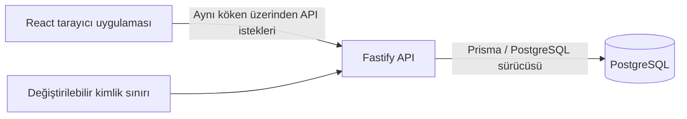

[English](README.md) | [Türkçe](README.tr.md)

# Kelime Çalışma Platformu

## Projeye Genel Bakış

İngilizce kelimeleri Türkçe anlamlarıyla öğrenmek için geliştirilen bir web uygulaması. Öğrenciler kendi listelerini oluşturur ve aynı kelimelerle farklı çalışma etkinlikleri yapar. Uygulama arayüzü Türkçedir; proje belgeleri İngilizce ve Türkçe olarak sunulur.

Proje, Adıyaman Üniversitesi öğrencileri için bir **Mesleki Yabancı Dil** ders projesi olarak başladı. Bağımsız bir geliştirme çalışmasıdır; üniversitenin onayını veya resmî bir üniversite hizmeti olduğunu ifade etmez.

## Özellikler

| Alan                         | Uygulanan davranış                                                                                                                                                             |
| ---------------------------- | ------------------------------------------------------------------------------------------------------------------------------------------------------------------------------ |
| Kişisel kelime listeleri     | Serbest başlıklarla liste oluşturma, yeniden adlandırma ve silme. Bir veya birden fazla Türkçe anlamı olan İngilizce ifadeleri ekleme, düzenleme ve silme.                     |
| Kelime kartları              | Her iki dil yönünde çalışma, cevabı açma ve kendi hatırlama durumunu değerlendirme.                                                                                            |
| Yazılı Cevap                 | Türkçe anlamları okuyup İngilizce ifadeyi yazma; belirlenmiş kurallara göre cevap geri bildirimi alma.                                                                         |
| Dinle ve Yaz                 | İngilizce ifadeyi dinleme, tekrar oynatma veya yavaşlatma ve duyduğunu yazma. Sesin kullanılabilirliği, yapılandırılan sağlayıcıya ya da tarayıcıdaki İngilizce sese bağlıdır. |
| Karma Çalışma                | Tek bir listeden veya tüm listelerinden kart, yazılı cevap, dinleme ve çoktan seçmeli soruları tek oturumda birleştirme.                                                       |
| Zorlanılan kelimeleri tekrar | Çalışma sonuçlarına göre tekrar için işaretlenen kelimelere odaklanan oturumlar.                                                                                               |
| Klasik test                  | Dört seçenekten Türkçe anlam grubunu seçme; anlamları örtüşen kelimeleri yanıltıcı seçenek olarak kullanmama.                                                                  |
| Eşleştirme                   | İngilizce ifadeleri Türkçe anlam gruplarına bağlama; eşleşen çiftleri aynı bağlantı numarasıyla gösterme.                                                                      |
| Hafıza Oyunu                 | İngilizce–Türkçe çiftleri bulmak için kartları ikişer açma.                                                                                                                    |
| Kelime Oluşturma             | Türkçe anlamı verilen İngilizce kelimeyi karışık harflerden oluşturma.                                                                                                         |
| Kelime Avı                   | Türkçe ipuçlarıyla harf tahtasında İngilizce ifadeleri bulma.                                                                                                                  |
| Çapraz Bulmaca               | Türkçe ipuçlarından kesişen İngilizce cevapları doldurma.                                                                                                                      |
| Oturumlar ve geçmiş          | Desteklenen çalışma oturumlarına ve bulmacalara devam etme; tamamlanan etkinlikleri ve kişisel sonuçları inceleme.                                                             |

Kart, yazılı cevap, dinleme, karma çalışma ve bulmaca oturumları sunucuda saklanır. Klasik test, Eşleştirme, Hafıza Oyunu ve Kelime Oluşturma sonuçları **tur tamamlandığında** kaydedilir; bu dört oyunun yarım kalan turları kaydedilmez. Bazı modlar yeterli sayıda uygun kelime gerektirir veya harf/uzunluk sınırlamaları uygular; hazırlık ekranı bu koşulları açıklar.

Liderlik tablosu, XP, rekabetçi sıralama veya ortak topluluk kelime havuzu yoktur. İsteğe bağlı örnek cümleler yalnızca seçilen bir kelime için açıkça istendiğinde alınır; otomatik oluşturulmaz. Varsayılan Docker geliştirme akışında dış örnek cümle erişimi ve Azure ses hizmeti kapalıdır. Dinleme, mevcutsa tarayıcının İngilizce sesini kullanabilir; ses yoksa bunu bildirir.

## Uygulama Ekran Görüntüleri

Bu ekran görüntüleri, bu kaynak kod belgelenen Docker akışıyla yerelde çalıştırılırken yalnızca yapay kelimelerle alındı. Kişisel liste veya çalışma kaydı içermez.

**Kontrol paneli**



**Çalışma modları**



**Liste ayrıntısı**



**Kelime kartları**



**Eşleştirme**



**Hafıza Oyunu**



**Kelime Avı**



Kurulum ekran görüntüsü eklenmedi; [Windows kılavuzu](docs/INSTALL_WINDOWS.tr.md) beklenen kurulum çıktısını metin olarak aynen gösterir. [Ekran görüntüsü notları](docs/images/README.md), bu görsellerin nasıl alındığını açıklar.

## Teknoloji Yığını

| Katman            | Teknolojiler                                                                  |
| ----------------- | ----------------------------------------------------------------------------- |
| Çalışma ortamı    | Node.js 24.x, npm workspaces                                                  |
| Ön yüz            | React, Vite, TypeScript 6, Tailwind CSS, Motion, React Router, TanStack Query |
| Arka uç           | Node.js, Fastify, TypeScript, Zod                                             |
| Veritabanı        | PostgreSQL, Prisma ORM 7; yerel Docker akışında PostgreSQL 18.6               |
| Arayüz varlıkları | Fontsource üzerinden Inter, Lucide simgeleri, projeye ait SVG/CSS çizimleri   |
| Kalite araçları   | Vitest, Testing Library, Node.js test çalıştırıcısı, ESLint, Prettier         |

Kesin bağımlılık sürümleri `package-lock.json` dosyasında kayıtlıdır.

## Mimariye Genel Bakış



- `apps/web`: sayfalar, ortak bileşenler, API istemcileri, tasarım değerleri ve ön yüz testleri.
- `apps/api`: kimlik sınırı, doğrulama, kelime/çalışma servisleri, API uçları, Prisma şeması, migration dosyaları ve testler.
- `scripts`: yerel geliştirme süreçlerini yöneten betikler ve Docker güvenlik kontrolleri.
- `compose.local.yml`: desteklenen yerel PostgreSQL kurulumu. Web ve API süreçleri Windows üzerinde, PostgreSQL ise Docker içinde çalışır.

Tarayıcı kodu SQL'e doğrudan bağlanmaz. Kişisel veriler, API'nin çözdüğü kullanıcı kimliğine göre sınırlandırılır. Yayın yolları `VITE_BASE_PATH`, `VITE_API_BASE_PATH` ve `API_PREFIX` ile ayarlanabilir; yerel kurulum üretim barındırması veya kimlik doğrulaması sağlamaz.

## Windows İçin Hızlı Başlangıç

Git, **Node.js 24.x (en az 24.11.0, 25'ten düşük)**, WSL 2 ve Docker Desktop kur. Docker Desktop'ı WSL 2 altyapısı ve Linux container'larıyla aç. PostgreSQL veya pgAdmin'i ayrıca kurman gerekmez. Resmî indirmeler, PowerShell kurulum seçenekleri ve sorun giderme için [ayrıntılı Windows kılavuzuna](docs/INSTALL_WINDOWS.tr.md) bak.

Normal bir PowerShell penceresinde kullanıcı klasörünü kullan:

```powershell
Set-Location $env:USERPROFILE
git clone https://github.com/Z3nes/vocabulary-learning-platform.git
Set-Location .\vocabulary-learning-platform
npm.cmd ci
npm.cmd run local:setup
npm.cmd run local:dev
```

Depo özel olduğu sürece klonlamak için erişim iznin gerekir. Klonlama adresine kimlik bilgisi ekleme.

[Uygulamayı aç](http://127.0.0.1:5173/). Veritabanı başlangıçta kelime içermez; bir liste oluşturup kendi kelimelerini ekle. Tanıtım sayfası `/tanitim`, yerel durum ekranı `/dev/status` yolundadır.

`local:setup`, yalnızca dosya yoksa rastgele parolalar içeren ve Git tarafından dışlanan `.env.docker` dosyasını oluşturur. Prisma Client'ı üretir, on sürümlü migration'ı uygular ve on üç model tablosunu doğrular. Varsayılan portlar web için **5173**, API için **3000**, PostgreSQL için **5433** olup yalnızca yerel bilgisayara bağlanır.

**Aynı bilgisayardaki başka bir proje kopyası bu Docker kurulumunu kullanıyorsa kuruluma başlamadan dur.** Yeni klasör, yeni Docker kimliği oluşturmaz. Ayrı Compose projesi, portlar ve veri birimi kullanmak için [ikinci kopya yönergelerini](docs/LOCAL_DEVELOPMENT.md#ayni-bilgisayarda-ikinci-kopya) izle.

Uygulamayı durdurmak için **Ctrl+C** kullan. Ardından bu proje klasöründe:

```powershell
npm.cmd run local:stop
```

PostgreSQL'in durdurulması adlandırılmış veri birimini ve yerel verileri korur. Veritabanını durdurduktan sonra yeniden `local:dev` çalıştırmadan önce `local:setup` çalıştır.

## Testler

`npm.cmd ci` sonrasında API'yi denetlemeden önce Prisma Client'ı üret. Üretim işlemi veritabanına bağlanmaz:

```powershell
npm.cmd run prisma:generate -w apps/api
npm.cmd run typecheck
npm.cmd run lint
npm.cmd run test:dev
npm.cmd run test -w apps/web -- --maxWorkers=4
npm.cmd run test -w apps/api -- --maxWorkers=4
npm.cmd run build
npm.cmd run format:check
```

Yukarıdaki API komutu, veritabanı bağımlılıkları taklit edilen birim testlerini çalıştırır. Entegrasyon testleri için önce kurulum kılavuzuyla kendine ait izole Docker ortamını oluştur, ardından:

```powershell
npm.cmd run local:test:integration
```

Bu komut hedefini doğrular ve container içindeki `vocabulary_local` veritabanından ayrı olan `vocabulary_local_test` veritabanını kullanır. Testleri kişisel çalışma kayıtları bulunan bir veritabanına yönlendirme ve entegrasyon paketlerini eşzamanlı çalıştırma. [Yerel yapılandırma bilgileri](docs/LOCAL_DEVELOPMENT.md) desteklenen ayarları açıklar.

## Katkıda Bulunanlar

Uygulamanın mevcut katkı bölümünde şu kişiler yer alır:

- Murat Kadir YILMAZ
- Muhammed Ali ATEŞ
- Zekeriye Enes AKÇİMEN

## Geliştirme ve Güvenlik Notları

- **Yalnızca geliştirme kimliği:** `AUTH_MODE=dev`, çalışan örneğe gelen tüm ziyaretçileri aynı demo kimliğine bağlar. Verilerin kullanıcıya göre modellenmesi, bu kurulumu güvenli bir herkese açık çok kullanıcılı hizmet yapmaz.
- `NODE_ENV=production`, geliştirme kimliğini reddeder. Herkese açık kayıt, üretim girişi, üniversite SSO'su veya topluluk listesi paylaşımı uygulanmamıştır. Geliştirme sunucusunu genel bir adres, tünel veya port yönlendirmesiyle internete açma. Yalnızca üretim derlemesi almak uygulamayı yayına hazır hâle getirmez.
- Veritabanı adreslerini ve isteğe bağlı sağlayıcı kimlik bilgilerini sunucuda tut. Gizli bilgileri `VITE_*` ayarlarına, ekran görüntülerine, hata bildirimlerine veya commit'lere koyma. Gerçek ortam dosyaları ve üretilen çıktılar `.gitignore` ile dışlanır.
- Desteklenen Docker akışı, ayrıca yapılandırılmış veritabanı adreslerini kullanmaz. Migration öncesinde container kimliğini, yerel port bağlamasını ve veri birimini doğrular. Yerel parolaları ve veri birimlerini koru; veri birimi silmek veya veritabanını sıfırlamak olağan bir onarım adımı değildir.
- İsteğe bağlı cümle/ses sağlayıcılarının kendi erişilebilirlik, atıf ve kullanım koşulları vardır. Entegrasyonları, hizmet garantisi veya çıktıları yeniden dağıtma izni anlamına gelmez.
- Proje lisansı henüz seçilmedi. Lisans eklemek için katkıda bulunanların onayı gerekir; bu aday açık kaynak lisansı iddiasında bulunmaz. Mevcut üçüncü taraf bildirimleri [Üçüncü taraf bildirimleri](docs/THIRD_PARTY_NOTICES.md) belgesinde ayrı olarak açıklanır.
